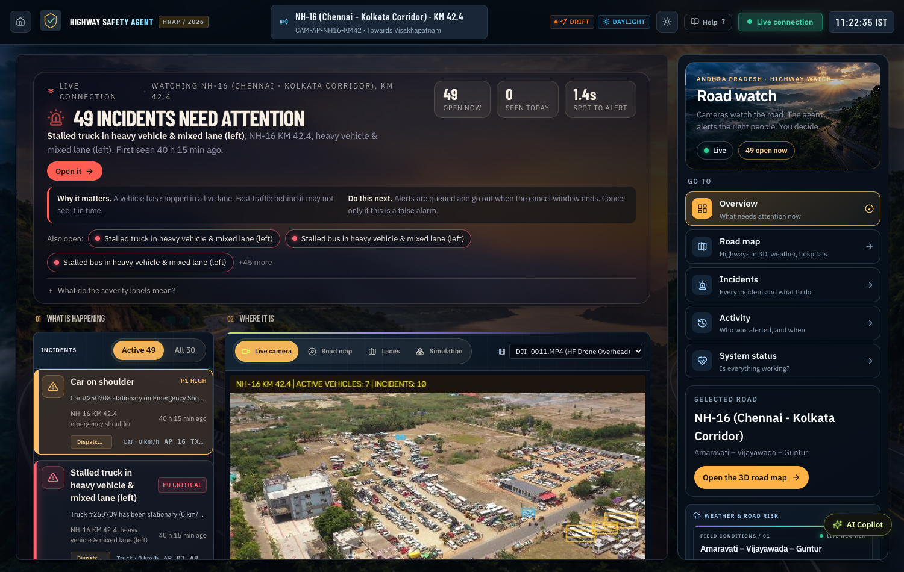
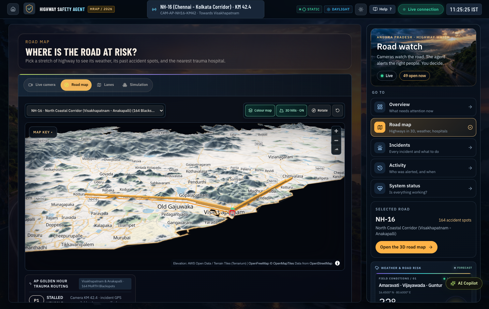
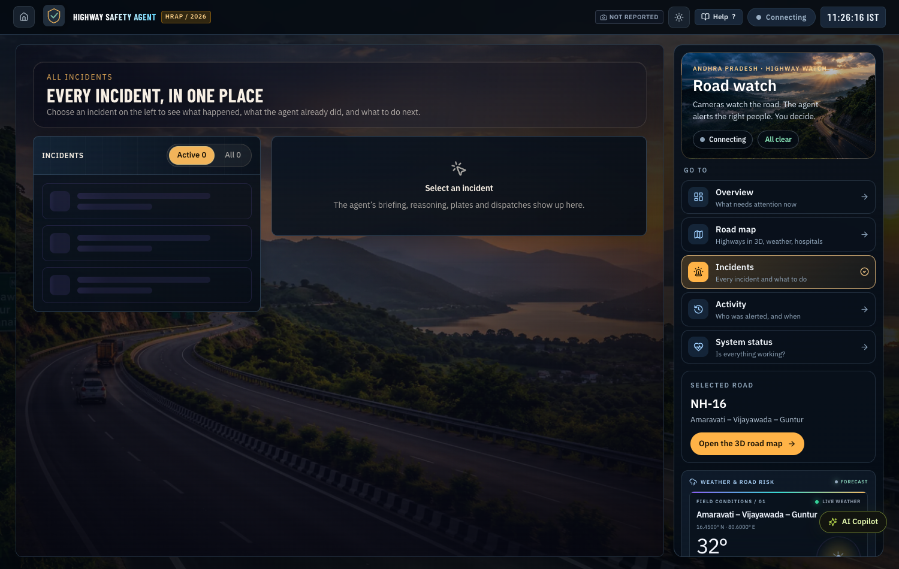
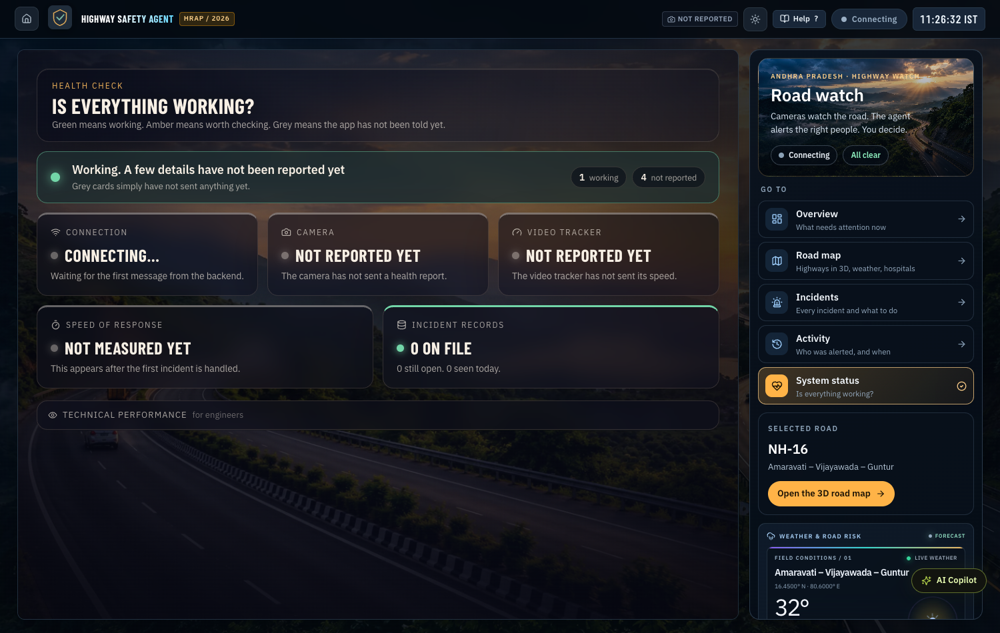
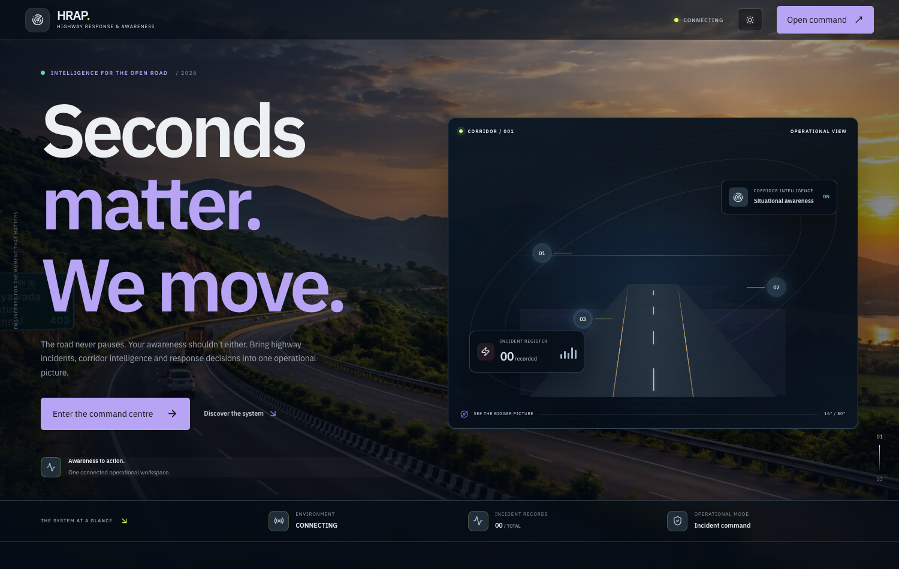

# Highway Safety & Accident Prevention Autonomous Agent

[](https://www.python.org/downloads/)
[](https://fastapi.tiangolo.com)
[](https://ultralytics.com)
[](https://react.dev)
[](https://vitejs.dev)
[](https://opensource.org/licenses/MIT)

An edge-first autonomous perception and cognitive safety agent designed for highway accident prevention, real-time collision hazard detection, and rapid emergency dispatch triage.

Built for the **Highway Road Accident Prevention Innovation Challenge (HRAP-2026)**.

---

## Command Center Interface & Operator Experience

The Operator Control Room UI is engineered for NHAI incident commanders, corridor traffic controllers, and trauma dispatchers, delivering sub-second situational awareness with zero cognitive clutter.

### 1. Tactical Incident Command & Live Telemetry

* **Top-Down Lane Telemetry Visualizer**: Real-time vehicle bounding boxes, kinematic velocity vectors, and multi-lane flow indicators running at 15–30+ FPS.
* **Golden Hour Ring**: Dynamic visual countdown timer calibrated to Indian MoRTH emergency response standards, ensuring trauma dispatch within critical survival windows.
* **Corridor Status TopBar**: Real-time stream health monitoring, AP corridor status pills, and active camera GPS coordinate markers.

---

### 2. 3D Digital Twin & Trauma Care Corridor Routing

* **High-Fidelity 3D Terrain**: Powered by MapLibre GL 3D with interactive terrain extrusion and multi-layer highway corridor telemetry.
* **Designated Level-1 Trauma Network**: Automated routing to regional medical facilities (**AIIMS Mangalagiri, GGH Guntur, GGH Vijayawada**) via OSRM emergency dispatch vectors.
* **Active Incident Beacons**: Georeferenced pulsating markers highlighting active hazards, congestion tails, and wrong-way vectors along NH-16 / NH-65.

---

### 3. Incident Triage & 4-Stage Cognitive Reasoning Trace

* **Deterministic Tier-0 Safety Floor**: Zero-LLM sub-3ms edge rules (Stalled Vehicle, Wrong-Way Driver, Tailgating TTC) strictly eliminate hallucination risks on life-safety triggers.
* **4-Stage Cognitive Audit Trace**: Every incident synthesizes an audit-ready **Observed → Assessed → Decided → Actions** trace for police, insurer, and NHAI compliance review.
* **15-Second Human-in-the-Loop Cancellation Guardrail**: Prevents premature or erroneous dispatches while guaranteeing automated transmission if unacknowledged.
* **Bilingual Multi-Channel Dispatch**: Automated emergency dispatches formatted in English and Telugu for local route patrols, 108 ambulance crews, and VMS gantries.

---

### 4. Edge System Health & Runtime Telemetry

* **Honest Runtime Instrumentation**: Actual measured FPS (never hard-coded defaults), isolated forward-pass latency, and circular evidence ring buffer telemetry.
* **Hardware Telemetry**: Memory consumption gauges, ONNX Runtime CPU session metrics (intra/inter op threads, memory arena status), and stream reconnection watchdogs.

---

### 5. Field Operations Gateway

* **Accessible Mission Landing**: High-contrast, tactile operations portal built for touch-screen field kiosks and central command video walls.

---

## Key Highlights

- **Edge Tracker Never Waits on the Agent**: Object detection, multi-object tracking, and kinematic estimation run in an in-process loop at 15–30+ FPS on edge CPUs.
- **The Agent Never Touches Raw Video**: Video frames remain on the edge device inside a 10-second circular ring buffer. Handoff to the agent is an event packet carrying track telemetry, crop references, and camera metadata.
- **ByteTrack & Kalman State Estimation**: Replaces naive centroid trackers with two-stage Hungarian association (IoU) and an 8-state Kalman Filter ($cx, cy, w, h, v_{cx}, v_{cy}, v_w, v_h$), eliminating ID switches across high-speed crossings.
- **Kinematic Smoothing & Spike Isolation**: 0.5-second sliding window velocity estimation with instantaneous teleportation guards ($> 200\text{ km/h}$) strictly preventing tracking artifacts from reaching the rules.
- **Sub-3ms Deterministic Rule Floor**: Zero-LLM edge trigger engine evaluating stalled vehicles (with congestion suppression), wrong-way drivers (multi-lane flow vectors), and tailgating time-to-collision (TTC).
- **Edge ANPR & Temporal Voting**: Morphological bumper isolation (bottom 45%), Sobel rectangular aspect gating, Tesseract OCR with Indian HSRP normalization (`AP 16 TX 4921`), multi-frame consensus voting across track frames, and stolen/hit-and-run hotlist alerts.
- **Strict On-Demand AI Intelligence & Operator Copilot**: Real-time perception and Tier-0 safety floor are 100% deterministic with zero automated background LLM calls (saving costs and edge latency). High-level reasoning is triggered on-demand via Parallel AI (`POST /api/incidents/{id}/explain` and `POST /api/copilot/chat`) for bilingual Telugu/English alerts, MoRTH blackspot analysis, and trauma care routing.
- **3D Digital Twin & Trauma Care Corridor Map**: MapLibre GL 3D interactive terrain map with OSRM ambulance routing to designated Level-1 trauma centres (AIIMS Mangalagiri, GGH Guntur, GGH Vijayawada), pulsating incident beacons, and offline SVG fallback.
- **Decoupled Asynchronous Evidence Buffer**: Offloads MP4 clip encoding and high-sharpness snapshot compression to background worker threads, preserving full perception FPS during incident bursts.
- **Cognitive Agent & 15-Second Operator Guardrails**: 4-stage audit trace (*Observed → Assessed → Decided → Actions*) and automatic stakeholder dispatch generation with a 15-second cancellation window before transmission.
- **Raspberry Pi 4 / 5 Production Ready**: Runs headlessly on low-cost ARM SBCs under 380 MB RAM with a dedicated systemd service unit. See [docs/EDGE_DEPLOYMENT_RASPBERRY_PI.md](docs/EDGE_DEPLOYMENT_RASPBERRY_PI.md).

---

## System Architecture

```
+-----------------------------------------------------------------------------------------+
|                                    EDGE DEVICE (CPU / SBC)                              |
|                                                                                         |
|  +-----------------------+     +-----------------------+     +-----------------------+  |
|  | Video Ingestion /     | --> | YOLOv8 ONNX Detector  | --> | ByteTrack + Kalman    |  |
|  | RTSP Stream           |     | (CPU Quantized)       |     | State Estimation      |  |
|  +-----------------------+     +-----------------------+     +-----------------------+  |
|              |                                                           |              |
|              v                                                           v              |
|  +-----------------------+                                   +-----------------------+  |
|  | Circular Ring Buffer  |                                   | Edge Trigger Engine   |  |
|  | (10s in-memory deque) |                                   | (Sub-3ms pure NumPy)  |  |
|  +-----------------------+                                   +-----------------------+  |
|              |                                                           |              |
|              | Background ThreadPool                                     | Candidate    |
|              v                                                           v Event        |
|  +-----------------------+                                   +-----------------------+  |
|  | Evidence Persistence  |                                   | Bounded Event Queue   |  |
|  | (MP4 Clip + JPEGs)    |                                   | (asyncio / mp.Queue)  |  |
|  +-----------------------+                                   +-----------------------+  |
+--------------------------------------------------------------------------|--------------+
                                                                           v
+-----------------------------------------------------------------------------------------+
|                                  COGNITIVE SAFETY AGENT                                 |
|                                                                                         |
|  +-----------------------------------------------------------------------------------+  |
|  | SafetyPolicyEngine (Deterministic Tier 0 Safety Floor)                            |  |
|  |  * Situation Briefing Synthesis                                                   |  |
|  |  * 4-Stage Reasoning Trace: Observed -> Assessed -> Decided -> Actions           |  |
|  |  * Stakeholder Dispatch Matrix (VMS Gantry, NHAI Route Patrol, 108 Ambulance)     |  |
|  +-----------------------------------------------------------------------------------+  |
|                                          |                                              |
|                                          v                                              |
|  +-----------------------------------------------------------------------------------+  |
|  | SQLite Persistent Storage (highway_incidents.db)                                  |  |
|  +-----------------------------------------------------------------------------------+  |
+--------------------------------------------------------------------------|--------------+
                                                                           v
+-----------------------------------------------------------------------------------------+
|                              OPERATOR CONTROL ROOM (React + Vite)                       |
|  [ Incident Queue ] <--------> [ Top-Down Lane Map ] <--------> [ Live Briefing & Trace]|
+-----------------------------------------------------------------------------------------+
```

For complete technical specifications, see [docs/ARCHITECTURE.md](docs/ARCHITECTURE.md).

---

## Repository Structure

```
.
├── agent/                      # Cognitive Agent layer
│   ├── parallel_client.py      # On-demand Parallel AI Web Intelligence client
│   ├── reasoning.py            # Tier 0 deterministic safety floor & 4-stage trace synthesis
│   └── worker.py               # Background event queue consumer worker
├── app/                        # Edge Perception & FastAPI backend
│   ├── anpr.py                 # Edge license plate OCR & multi-frame temporal consensus
│   ├── detector.py             # YOLOv8 ONNX CPU object detector
│   ├── tracker.py              # ByteTrack two-stage IoU association + Kalman Filter
│   ├── incident_rules.py       # Pure NumPy/Python edge trigger rules (Stalled, Wrong-way, TTC)
│   ├── evidence_buffer.py      # Circular ring buffer & decoupled async MP4/JPEG encoding
│   ├── incident_schema.py      # Incident contracts and Pydantic data models
│   └── main.py                 # FastAPI REST and SSE live stream endpoints
├── config/                     # Configuration definitions
│   ├── ap_highway_corridors.json # AP highway corridors & Level-1 trauma centers
│   ├── camera_config.json      # Camera GPS, lane polygons, flow vectors, and contacts
│   └── safety_rules.json       # Tracker, motion, and rule threshold parameters
├── docs/                       # Architecture & design documentation
│   ├── ARCHITECTURE.md         # Comprehensive system design document
│   ├── MODEL_MIGRATION_REPORT.md # Evidence-led model migration & factor attribution report
│   ├── COMPARISON_HARNESS_NOTES.md # 2x2 factor attribution & latency tail specifications
│   ├── EDGE_DEPLOYMENT_RASPBERRY_PI.md # Raspberry Pi 4/5 SBC deployment guide
│   └── assets/                 # High-resolution UI screenshots & previews
├── frontend/                   # React + Vite Operator Control Room UI
│   ├── src/                    # Components (CorridorMap3D, LiveStage, IncidentDetail, etc.)
│   └── package.json            # Node dependencies
├── models/                     # Model binaries and provenance tracking
│   ├── PROVENANCE_coco_320.md  # Checksum & export provenance documentation
│   └── yolov8n.onnx            # YOLOv8 nano quantized for edge CPU inference
├── reports/                    # Small benchmark verification reports
│   ├── detector_baseline.json  # 1,554-image VisDrone baseline report (immutable reference)
│   └── detector_attribution.json # 4-way factor attribution & latency tail report
├── tests/                      # Synthetic and acceptance verification suites
│   ├── test_comparison_harness.py # Factor attribution & transform verification
│   ├── test_eval_detector_guard.py # Immutable baseline & fail-closed safety tests
│   ├── test_detector_iobinding.py # Optional ORT reusable output buffer tests
│   ├── test_tracker_and_rules.py # 8-scenario synthetic tracker & rule verification suite
│   └── test_replay_harness.py  # Phase 1 acceptance benchmark harness
└── tools/                      # Engineering & benchmark utilities
    ├── calibrate_camera.py     # Interactive lane calibration and polygon configuration tool
    ├── comparison_harness.py   # Deployed/letterbox & fused decoding transform engine
    ├── eval_detector.py        # COCO mAP & latency profiling evaluator
    ├── eval_detector_attribution.py # 4-way factor attribution experiment runner
    ├── visdrone_loader.py      # Resilient cached VisDrone dataset loader
    ├── highway-safety.service  # Production systemd service unit for edge SBCs
    └── replay_video.py         # Headless video replay benchmark & contact sheet generator
```

---

## Quick Start

### 1. Backend Setup

```bash
# Clone the repository
git clone https://github.com/darayavahoush/highway-safety-agent.git
cd highway-safety-agent

# Create virtual environment and install dependencies
python3 -m venv .venv
source .venv/bin/activate
pip install -r requirements.txt
```

### 2. Run the Backend

#### Live Video Stream Mode
```bash
VIDEO_SOURCE="demo_videos/drone/DJI_0011.MP4" python -m uvicorn app.main:app --host 0.0.0.0 --port 8000
```

#### Simulation Mode (for headless testing)
```bash
ENABLE_SIMULATION=1 python -m uvicorn app.main:app --host 0.0.0.0 --port 8000
```

### 3. Run the Control Room Frontend

```bash
cd frontend
npm install
npm run dev
```

Open [http://localhost:5173](http://localhost:5173) in your browser.

---

## Verification & Testing

### 1. Synthetic Tracker & Rules Test Suite (8 Scenarios)
Verifies track persistence across missing frames, crossover identity preservation, speed spike rejection, shoulder stop P2 isolation, congestion suppression, and closing-speed tailgating:
```bash
python tests/test_tracker_and_rules.py
```

### 2. Phase 1 Acceptance Test Suite
Verifies rules firing, deduplication cooldown, evidence encoding, cognitive reasoning synthesis, and sub-3ms rule overhead:
```bash
python tests/test_replay_harness.py
```

### 3. Headless Video Replay Benchmark
Runs recorded footage through the full edge perception pipeline headlessly, outputs timing metrics, HTML contact sheet, and review CSV:
```bash
# Full rate replay
python tools/replay_video.py --video demo_videos/drone/DJI_0011.MP4 --out replay_output/DJI_0011

# Rate-limited 12 Hz edge simulation
python tools/replay_video.py --video demo_videos/drone/DJI_0025.MP4 --process-hz 12.0 --out replay_output/DJI_0025_12hz
```

---

## License

This project is licensed under the MIT License - see the [LICENSE](LICENSE) file for details.
